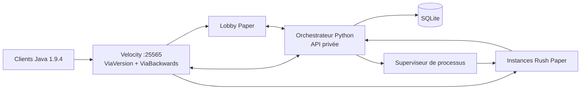

# Rush Training

Réseau Minecraft Java pour entraîner les joueurs d’un tournoi : lobby, parties Rush déployées à la demande, matchmaking 1v1/2v2/5v5, équipes, amis, parties privées et classements persistants.

**Client de référence : Java 1.9.4, comme Funcraft V2.** Le moteur est Paper 1.21.11, avec traduction ViaVersion/ViaBackwards sur Velocity et transfert d’identité BungeeGuard. Le combat est personnalisé, sans cooldown d’attaque. Ce projet n’utilise ni le code ni les cartes originales de Funcraft : les valeurs PvP et l’arène sont une première base à calibrer en jeu.

## Installation sur une VM Linux

Ubuntu 22.04+/Debian 12+ ou Fedora/RHEL, avec systemd. Sur la machine de développement :

```sh
bash scripts/package.sh                      # → dist/rush-server/ et dist/rush-server.tar.gz
scp dist/rush-server.tar.gz user@vm:~
```

Sur la VM :

```sh
tar xzf rush-server.tar.gz && cd rush-server
sudo ./install.sh                            # demande l’acceptation de l’EULA ; --accept-eula en non interactif
```

Le script installe Java 21 (dépôt Temurin si la distribution ne le fournit pas), Python et curl, crée l’utilisateur système `rush`, copie le réseau dans `/opt/rush`, télécharge les serveurs vérifiés par SHA-256, génère les clés, règle `max_instances` selon la RAM, ouvre 25565/TCP si ufw ou firewalld est actif, installe et démarre le service systemd, puis attend que le lobby réponde. Relancer `sudo ./install.sh` avec une nouvelle archive met à jour le code et redémarre le service sans toucher à `runtime/` (base, clés, réglages locaux). Options : `--dir`, `--user`, `--no-service`, `--no-start`.

Administration ensuite avec `rush status`, `rush role <pseudo> admin`, `rush deploy-test --mode 5v5`, `rush logs`, `rush stop|start|restart`.

## Démarrage en développement

Prérequis : macOS ou Linux, Java 21+ (testé avec Java 25), Python 3.11+, `curl`, `tar`. Maven est téléchargé localement si absent. Prévoir environ 8 Go de RAM et 4 vCPU pour le lobby, le proxy (512 Mo) et quatre parties à 1 Go de heap chacune (`max_instances`, `memory_mb`), plus le système et la mémoire native ; ajuster au serveur cible après mesure.

```sh
bash scripts/build.sh
python3 scripts/download.py
# À exécuter uniquement après avoir accepté https://www.minecraft.net/eula
python3 -m orchestrator.cli init --accept-eula
python3 -m orchestrator.cli start --diagnostic
```

Connexion Minecraft : `localhost:25565` sur la machine locale, ou l’adresse de l’hôte pour les autres joueurs. Le proxy authentifie les comptes Minecraft Java officiels. Seul le port **25565/TCP** doit être exposé. Les instances et l’API écoutent uniquement sur `127.0.0.1`.

L’EULA a été acceptée pour les essais dans cet espace de travail ; ce choix reste dans `runtime/settings.json`, ignoré par Git. Les clés sont générées par `init` et ne sont pas versionnées.

```sh
python3 -m orchestrator.cli status
python3 -m orchestrator.cli role VotrePseudo admin  # après une première connexion
python3 -m orchestrator.cli stop
```

`start` tourne au premier plan. Sur un serveur permanent, utiliser un gestionnaire de services ; un exemple systemd est fourni dans `docs/rush.service`. L’arrêt termine les processus enfants. Le réseau démarre proprement à nouveau ; les parties interrompues sont annulées sans attribuer de points.

## Fonctionnement



Un processus Paper et un monde isolé par partie. Le superviseur limite le nombre d’instances, attend le signal de disponibilité du plugin, réserve les ports jusqu’à l’arrêt effectif et annule les parties dont le processus échoue. Le proxy enregistre les nouveaux serveurs et transfère automatiquement les participants. À la fin, les joueurs reviennent au lobby.

Le matchmaking forme deux équipes de taille exacte en conservant les groupes. Un groupe trop grand est refusé. Les joueurs déconnectés sont retirés des files. La file reste en attente si la capacité est atteinte. Les joueurs solo peuvent compléter une équipe. Il s’agit d’un matchmaking par mode et composition, **sans recherche par Elo**.

## Commandes et menus

`/rush` ou la boussole ouvre l’interface d’inventaire : modes, équipes, amis, classements et parties privées. Les invitations reçues peuvent être acceptées dans le menu ; la saisie d’un pseudo ou d’un code privé se fait par commande.

| Commande | Usage |
|---|---|
| `/rush 1v1`, `/rush 2v2`, `/rush 5v5` | Inscription du joueur ou de l’équipe, par le chef |
| `/rush leave` | Quitter la file/le salon ou abandonner une partie |
| `/rush status` | Rôle, équipe et état du réseau |
| `/team invite <pseudo>` | Invitation persistante, 5 membres maximum |
| `/team accept <pseudo>` | Accepter l’invitation du chef |
| `/team list`, `/team leave`, `/team kick <pseudo>` | Gérer l’équipe ; le départ du chef la dissout |
| `/friend add <pseudo>`, `/friend accept <pseudo>` | Demande d’amitié avec acceptation explicite |
| `/friend list`, `/friend remove <pseudo>` | Amis, demandes et présence |
| `/private create <mode>` | Créer un salon privé non classé |
| `/private join <code>`, `/private list` | Rejoindre et voir les camps |
| `/private start` | Démarrer un salon complet, par son créateur |
| `/leaderboard [global\|1v1\|2v2\|5v5]` | Top 10 par Elo puis victoires |
| `/shop` | Boutique, à proximité de sa base |
| `/rush admin` | Voir les parties actives, modérateur ou administrateur |
| `/rush admin abort <id>` | Annuler sans résultat, modérateur ou administrateur |
| `/rush admin role <pseudo> <rôle>` | Changer un rôle, administrateur uniquement |

Rôles centralisés : `player`, `moderator`, `admin`. L’attribution initiale se fait avec la CLI locale. Les comptes doivent s’être connectés au moins une fois pour être ciblés. Les permissions sont contrôlées côté API, avec les UUID authentifiés du proxy ; elles ne reposent pas sur une valeur envoyée par le client Minecraft.

Les salons privés placent les participants alternativement rouge/bleu selon l’ordre d’arrivée. Ils expirent après 30 minutes ou au départ de leur créateur. Une équipe ne peut pas être modifiée pendant une inscription ou une partie.

## Règles livrées

- Deux bases sur des îles, une île centrale et des lits. Construction jusqu’à Y=110. Les blocs de la carte sont protégés ; les blocs placés sont destructibles.
- Bronze représenté par des briques toutes les secondes, fer toutes les 5 secondes, or au centre toutes les 10 secondes. Les ressources au sol sont plafonnées par générateur.
- Boutique : blocs, épées, plastrons, pioche, TNT, briquet, pommes dorées. TNT à allumer au briquet ; explosion des constructions et propulsion des joueurs, sans dégâts directs d’explosion.
- À la mort, l’équipement acheté et les ressources tombent au sol (l’épée en bois de départ est redonnée). Réapparition après 3 secondes tant que le lit existe ; protection de 2 secondes après réapparition, qui empêche aussi d’attaquer. Sans lit, la mort élimine le joueur.
- Pas de dégâts entre alliés, de faim, de dégâts de chute, de balayage ni de bonus critique moderne. Les dégâts des armes sont fixés ; l’armure suit la formule 1.8 (4 % par point, 80 % maximum). Invulnérabilité de 10 ticks entre deux coups, comme en 1.8 (`hurt_ticks: 20`, Paper en applique la moitié). Le knockback reçoit le bonus de sprint 1.8, consommé par le coup : enchaîner demande un sprint reset (W-tap).
- Une déconnexion en cours de partie est un abandon définitif. Tous les participants doivent arriver sous 120 secondes ; sinon la partie est annulée.
- Lits détruits après 20 minutes ; match nul et sans classement après 25 minutes. Aucun spectateur externe ; un joueur éliminé peut observer sa partie.
- Classement Elo initial 1000, K=32, résultat collectif, calcul par mode et global. Résultats enregistrés atomiquement une seule fois. Statistiques : victoires, défaites, kills, morts, lits. Les parties privées et annulées ne comptent pas.

## Configuration et diagnostics

Modifier `config/settings.json` pour les valeurs partagées ; `runtime/settings.json` permet des surcharges locales. Les réglages PvP sont indépendants pour chaque mode : `attack_speed`, `hurt_ticks`, knockback horizontal/vertical, bonus de sprint `knockback_sprint_horizontal`/`knockback_sprint_vertical`, propulsion TNT horizontale/verticale. Une surcharge de `pvp` dans `runtime/settings.json` remplace le bloc entier : y recopier toutes les clés. **Redémarrer le réseau après modification.** Aucun rechargement à chaud ne change les règles d’une partie en cours.

L’API utilise le port 8787 par défaut. Dans l’espace de travail où le projet a été développé, ce port était occupé : la surcharge locale utilise **18787**.

```sh
python3 -m orchestrator.cli start --diagnostic
python3 scripts/analyze_logs.py runtime
```

Les événements de cycle de vie sont toujours enregistrés. `--diagnostic` ajoute `pvp_hit`, `tnt_launch` et des mesures TPS : UUID, dégâts, distance, ping, vecteur de propulsion et durée d’invulnérabilité. Les fichiers JSONL tournent par tranches de 10 Mo, avec cinq générations.

| Fichier | Contenu |
|---|---|
| `runtime/events.jsonl` | Files, déploiements, disponibilités, résultats, permissions et erreurs API |
| `runtime/servers/<id>/plugins/Rush/events-*.jsonl` | Partie et diagnostic PvP |
| `runtime/servers/<id>/console.log` | Console Paper |
| `runtime/proxy/console.log` | Connexions et transferts |
| `runtime/rush.sqlite3` | Amis, équipes, rôles, résultats et classements |

Sauvegarder SQLite avec son API de sauvegarde ou arrêter le réseau avant de copier la base. À l’arrêt d’une partie, son dossier est réduit à `console.log`, `logs/` et `plugins/Rush/events-*.jsonl` (quelques dizaines de Ko) : le monde, les jars et `instance.json` (qui contient le jeton API) sont supprimés. Purger ces journaux selon la durée de conservation choisie, par exemple `find runtime/servers -maxdepth 1 -name 'rush-*' -mtime +14 -exec rm -rf {} +`. Les fichiers contiennent des UUID et pseudos ; limiter leur accès et choisir une durée de conservation.

## Performances

Chaque partie est un processus Paper isolé (environ 5,5 s de démarrage mesuré sur macOS ARM64, contre 8,9 s avant optimisation). Les instances réutilisent par liens symboliques les bibliothèques et le cache de remapping du lobby, ne chargent ni Nether ni End, ne sauvegardent pas leur monde et laissent la compression réseau au proxy. Les JVM utilisent G1 avec les réglages d’Aikar et `-Xms` égal à `-Xmx`. La capacité dépend de `max_instances` × `memory_mb` : aucun test de charge n’a été réalisé.

## Tests

```sh
python3 -m unittest discover -s tests -v
bash scripts/build.sh
# Réseau démarré dans un autre terminal :
python3 -m orchestrator.cli deploy-test --mode 1v1
python3 -m orchestrator.cli deploy-test --mode 2v2
python3 -m orchestrator.cli deploy-test --mode 5v5
# Partie complète avec deux clients automatisés 1.9.4 :
npm install --prefix .cache/bots mineflayer@4.33.0 --no-audit --no-fund
python3 scripts/smoke_network.py
```

`deploy-test` démarre un vrai processus, attend le plugin, interroge le protocole Minecraft et arrête l’instance. `smoke_network.py` utilise un réseau distinct sous `.cache/network-*`, une base séparée et un proxy offline **limité à localhost**. Il ne désactive pas l’authentification du réseau normal. Les bots vérifient les commandes sociales, l’interface, le matchmaking, le transfert, des attaques répétées, la boutique, la TNT, les lits, la réapparition, une élimination, le classement, le retour au lobby et une partie privée sans points. Les téléportations et ressources de préparation sont exécutées par la console de test. La simulation de déplacement de Mineflayer est désactivée car elle produit des coordonnées non finies avec ce client ancien : ces tests ne valident donc pas le ressenti des déplacements, la trajectoire réelle du knockback ni le TNT fly côté client.

Voir `docs/validation.md` pour les essais réellement effectués et leurs limites. Le ressenti Funcraft, les maps finales et un test de charge sur la machine d’hébergement restent des validations de terrain.

## Références

- [Archive du forum Funcraft recommandant 1.9.4](https://funcraft.nixuge.me/forum/threads/un-probleme-avec-mon-launcher-help.74738/).
- [Compatibilité et transfert d’identité Velocity](https://docs.papermc.io/velocity/player-information-forwarding/).
- [Installation officielle BungeeGuard](https://github.com/lucko/BungeeGuard/blob/master/INSTALLATION.md).
- [Documentation ViaVersion](https://viaversion.atlassian.net/wiki/spaces/VIAVERSION/pages/54100023/).

Les binaires amont sont épinglés dans `config/artifacts.lock.json` et vérifiés par SHA-256. Les dépendances API Maven utilisent les versions SNAPSHOT propres aux projets Paper/Velocity ; le cache local fige les artefacts résolus pour ces builds.
